# 🚕 Al Toque — Aplicación móvil de solicitudes de taxi

**Proyecto de tesis de Ingeniería Informática**  
Flutter · Dart · Firebase · Google Maps

Al Toque es un prototipo de aplicación móvil para la gestión de solicitudes de taxi, con interfaces diferenciadas para pasajeros y conductores.

El proyecto fue desarrollado en el contexto de un trabajo académico orientado a las necesidades de la **Asociación de Transporte Libre Radio Móvil San Pedro Ltda.**, en Yacuiba, Bolivia.

> **Estado:** prototipo académico. No es un servicio de transporte actualmente operativo.
>
> **Repositorio:** documentación técnica y capturas de pantalla. El código fuente no está publicado aquí.

## 📌 Descripción del proyecto

Al Toque propone una solución móvil para facilitar la comunicación entre pasajeros y conductores durante la solicitud y realización de viajes.

El prototipo contempla dos experiencias:

| Pasajero | Conductor |
|---|---|
| Solicitar servicios de taxi | Recibir solicitudes |
| Visualizar ubicaciones y rutas | Consultar rutas de viaje |
| Consultar el estado del servicio | Iniciar y finalizar viajes |
| Calificar al conductor | Calificar al pasajero |
| Gestionar información del perfil | Consultar información e historial de viajes |

Las funcionalidades corresponden a los módulos documentados del prototipo y no implican que todos los procesos estén actualmente operativos de extremo a extremo.

## 🛠️ Tecnologías utilizadas

| Tecnología | Uso |
|---|---|
| **Flutter y Dart** | Desarrollo de la aplicación móvil |
| **Firebase Authentication** | Autenticación de usuarios |
| **Cloud Firestore** | Persistencia y consulta de información |
| **Firebase Cloud Messaging** | Mensajería y notificaciones |
| **Firebase Storage** | Gestión de archivos |
| **Google Maps** | Mapas y visualización de recorridos |
| **Geolocator y Geocoding** | Ubicación y geocodificación |
| **Lottie** | Animaciones de interfaz |

## 💻 Contribuciones técnicas y adaptaciones

El proyecto tomó como punto de partida una aplicación de ejemplo de un curso de Flutter disponible en Udemy, utilizada como base de aprendizaje.

A partir de esa base, se identificaron adaptaciones realizadas para el trabajo académico.

### Historial de viajes del conductor

Se incorporaron pantallas y controladores para consultar viajes registrados y visualizar su información detallada.

Esta adaptación involucró:

- Desarrollo de interfaces para listar y consultar viajes.
- Incorporación de pantallas de detalle.
- Reutilización de modelos y proveedores existentes.
- Integración con la navegación de la aplicación.

### Personalización de interfaces

Se adaptó la presentación de la aplicación al contexto del servicio de transporte local mediante:

- Modificación de elementos visuales y textos.
- Personalización de la identidad de la aplicación.
- Adaptación de la pantalla inicial y selección de perfiles.
- Incorporación de una animación de presentación con Lottie.

### Mantenimiento y adaptación del código

Durante el desarrollo académico se realizaron ajustes en:

- Manejo de tipos anulables (*null safety*) en Dart.
- Controladores y navegación.
- Compatibilidad y mantenimiento del proyecto Flutter.

### Trabajo con servicios externos

El proyecto permitió trabajar con una aplicación que integra Firebase y Google Maps para autenticación, persistencia de datos, notificaciones y representación de ubicaciones.

**Aclaración sobre la autoría:** las funcionalidades provenientes del curso no se presentan como implementaciones originales. Las contribuciones descritas corresponden a adaptaciones identificadas respecto al material de referencia.

## 🏗️ Organización técnica

El prototipo utiliza una estructura organizada principalmente en:

- **Pages:** pantallas e interfaces de usuario.
- **Controllers:** lógica asociada a las pantallas y navegación.
- **Models:** representación de entidades y datos.
- **Providers:** acceso a servicios y operaciones con información.
- **Utilities:** funciones y recursos auxiliares.

La aplicación interactúa con servicios de Firebase y Google para sus funcionalidades relacionadas con usuarios, datos y mapas.

## 📸 Galería de capturas

Las siguientes imágenes documentan las interfaces del prototipo académico.

### Experiencia del pasajero

**Solicitud y asignación del servicio**

  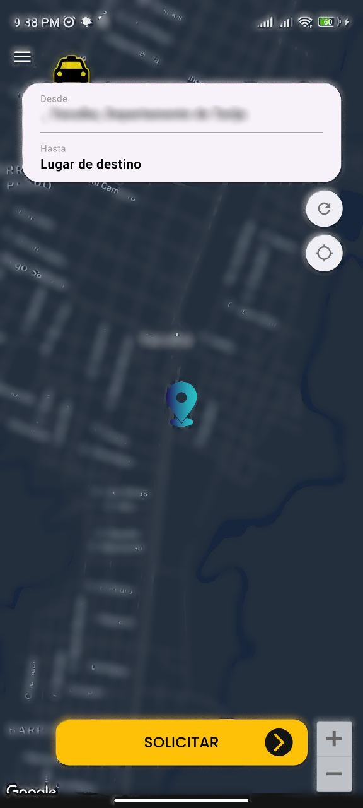
  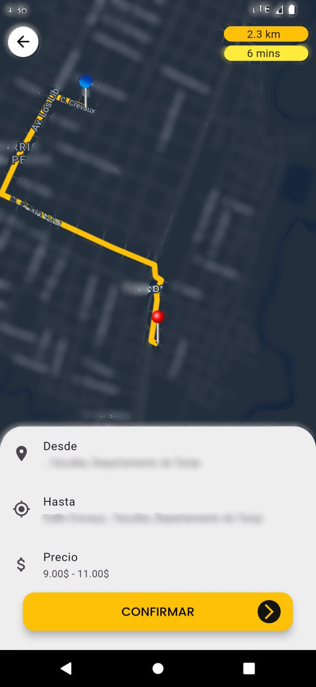
  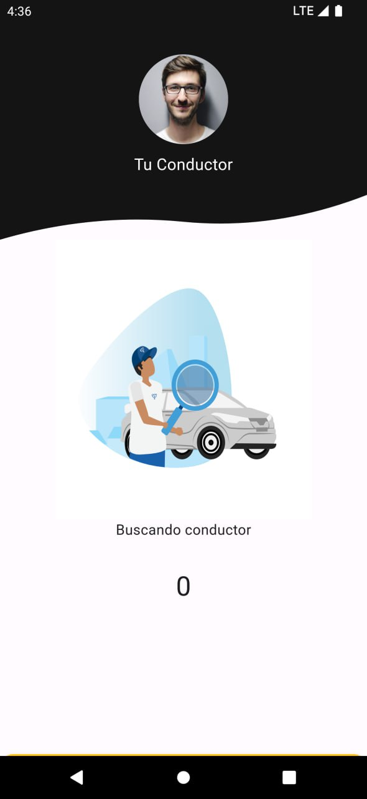
  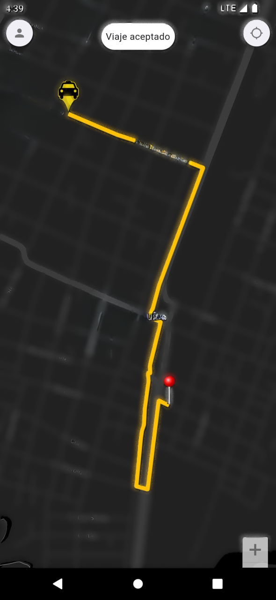

**Seguimiento, finalización y perfil**

  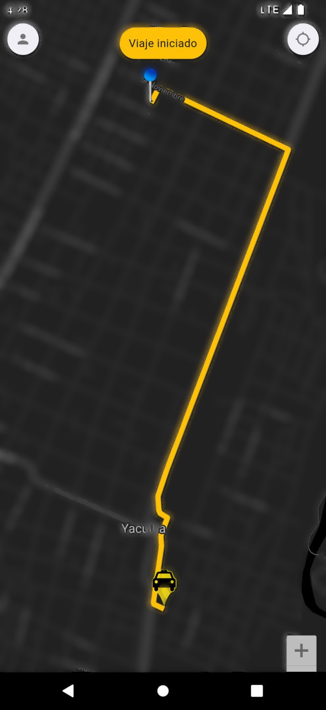
  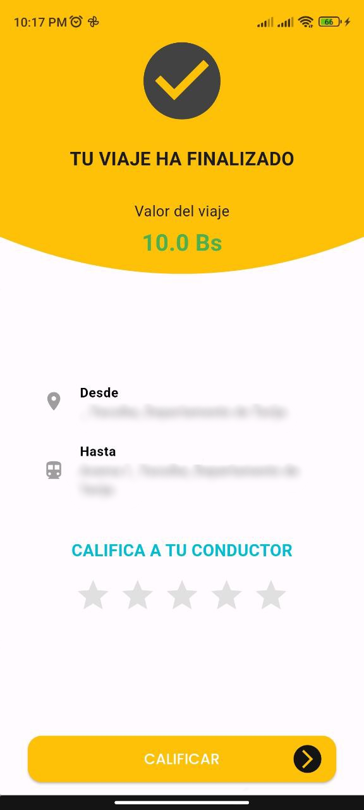
  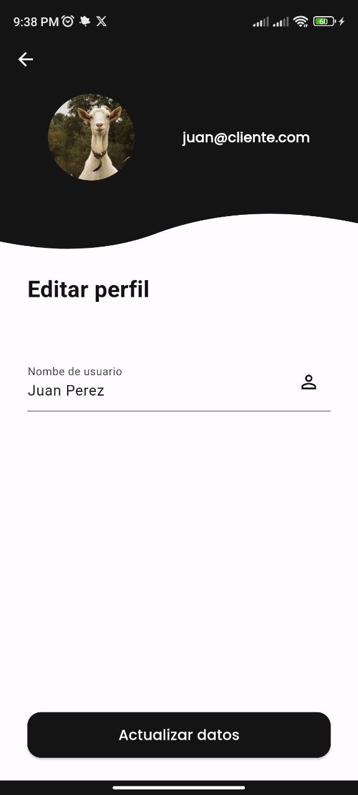

### Experiencia del conductor

**Disponibilidad y recepción de solicitudes**

  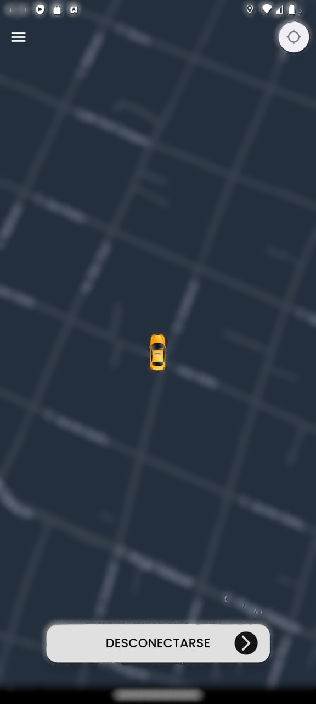
  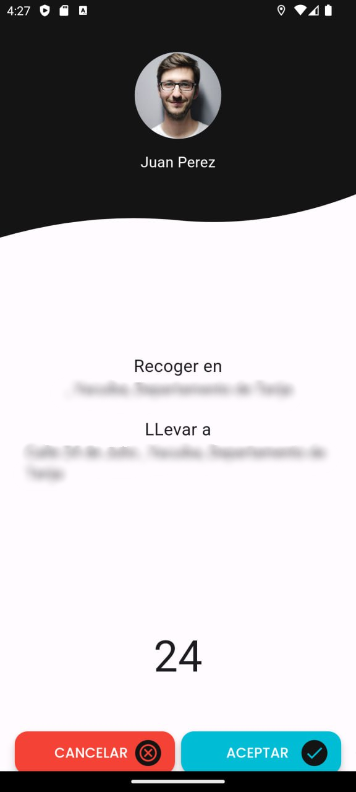

**Gestión y finalización del recorrido**

  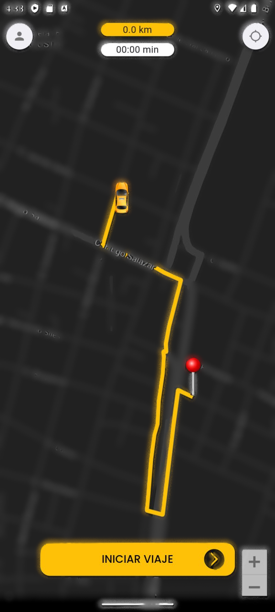
  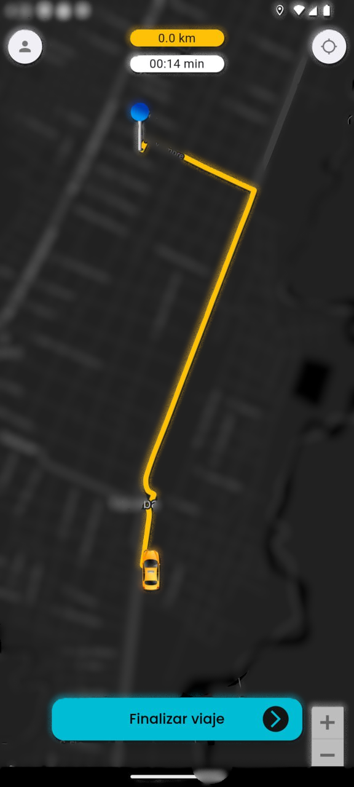
  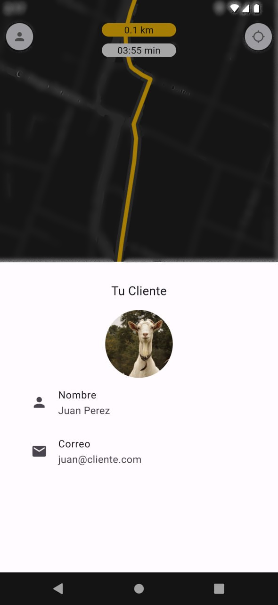
  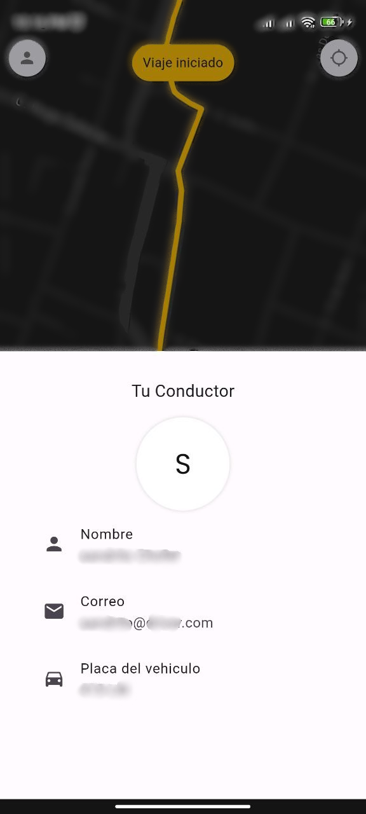
  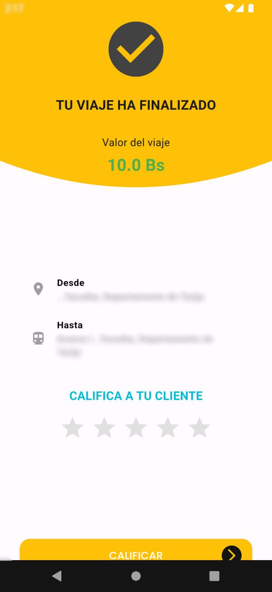

> Las capturas se presentan con fines de documentación académica. Los mapas y otros datos visibles fueron desenfocados para reducir la exposición de información sensible.

## 🎯 Conocimientos aplicados

Este proyecto permitió trabajar con:

- Desarrollo móvil multiplataforma con Flutter.
- Programación y mantenimiento de código Dart.
- Integración de servicios Firebase.
- Persistencia de información mediante Cloud Firestore.
- Uso de mapas y servicios de geolocalización.
- Organización de interfaces, controladores y modelos.
- Adaptación y ampliación de una base de código existente.

## 📋 Alcance y limitaciones

- Al Toque es un **prototipo académico**, no una aplicación comercial desplegada.
- Este repositorio contiene documentación y evidencias visuales, no el código fuente completo.
- Las integraciones externas pueden requerir nuevas configuraciones para funcionar.
- El código utilizado como base de aprendizaje no se redistribuye aquí; cualquier publicación futura deberá respetar las licencias y autorizaciones correspondientes.

## 👨‍💻 Autor

**Juan Bautista Padilla Caihuara**  
Ingeniería Informática  
Universidad Autónoma Juan Misael Saracho  
Yacuiba, Bolivia

[GitHub](https://github.com/juanbpadilla) · [LinkedIn](https://www.linkedin.com/in/juan-padilla-ba013a17a/)

---

*Al Toque — Proyecto académico de Ingeniería Informática.*
